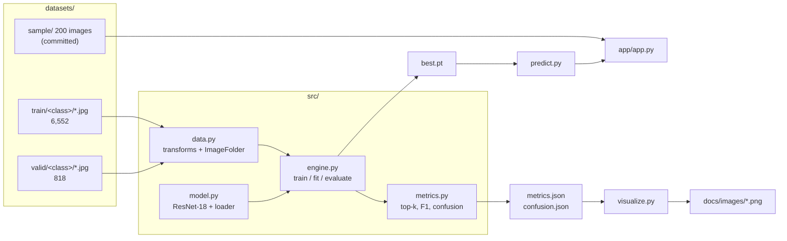

<div align="center">

# Flower Recognition · ResNet-18

**102 flower species classified from a 64×64 crop, trained in two stages, shipped with a working demo — and with the one bug that makes most of these projects look wrong in production.**

[](https://www.python.org/)
[](https://pytorch.org/)
[](https://pytorch.org/vision/stable/)
[](https://flask.palletsprojects.com/)
[](LICENSE)

**English** · [简体中文](README.zh-CN.md)

[Overview](#-overview) · [Results](#-results) · [Quick start](#-quick-start) · [How it works](#-how-it-works) · [Design notes](#-design-notes) · [Dataset](#-dataset) · [FAQ](#-faq)

</div>

<p align="center">
  
</p>

---

## 📌 Overview

Fine-tune an ImageNet ResNet-18 to tell 102 flower species apart, in a project
that stops where most coursework repositories start: a checkpoint you can load
without guessing the key names, metrics you can reproduce with one command, a
figure set regenerated from data rather than screenshots, and a demo that labels
new photos.

| | |
| :-- | :-- |
| **Task** | 102-way single-label classification (Oxford Flowers 102 subset) |
| **Model** | ResNet-18, 11.23 M parameters, 64×64 input |
| **Training** | 2 stages × 50 epochs: frozen backbone, then full fine-tune |
| **Validation accuracy** | **69.32 %** top-1 · **85.33 %** top-3 · **89.24 %** top-5 |
| **Throughput** | ~243 images/s (batched-128, RTX 3050 Laptop, fp32) |

The interesting part is not that a ResNet classifies flowers. It is the three
things that quietly break in projects like this one, all handled here:

1. **Class-index vs. label mapping.** `ImageFolder` sorts folder names as
   *strings*, so `1, 10, 100, 101, 102, 11, …` — not `1, 2, 3`. A demo that maps
   `str(index + 1)` is right for exactly one class out of 102. See
   [`datasets/README.md`](datasets/README.md#why-classesjson-matters).
2. **Checkpoint formats drifting.** Three shapes existed across the four
   original scripts (`{'state_dict': …}`, a bare `state_dict`, a
   `DataParallel`-wrapped one). One loader normalises all three.
3. **Augmentation that silently destroys the label.** Rotate-then-crop and
   resize-then-rotate are not the same thing at 64 px; the order is documented
   and pinned in `src/data.py`.

---

## 📊 Results

Measured with the released checkpoint on the 818-image validation split
(`python -m src.evaluate`):

| Metric | Value |
| :-- | --: |
| Top-1 accuracy | **0.6932** |
| Top-3 accuracy | 0.8533 |
| Top-5 accuracy | 0.8924 |
| Macro F1 | 0.6551 |
| Weighted F1 | 0.6936 |
| Cross-entropy | 1.5116 |
| Images / s (RTX 3050 Laptop, fp32, batch 128) | 243 |

<sub>The checkpoint records `best_acc = 0.6956` from its own evaluation during
training. The 2-image (0.24 pt) difference is expected: batch composition and
cuDNN kernel choice change which side of the margin a handful of borderline
images land on. Both numbers are stated rather than picking the flattering one.</sub>

<p align="center">
  
</p>

Read the accuracy panel left to right and the schedule becomes visible:

- **Epochs 0–49 — frozen backbone.** Only the new 102-way head learns. Validation
  accuracy climbs to 0.36 and then flattens: 512 frozen features cannot separate
  102 flower species.
- **Epoch 50 — unfreeze.** The jump from 0.36 to 0.69 happens in about six
  epochs. This is the whole argument for two-stage training: the head has
  already found a usable direction before the backbone starts moving, so the
  first fine-tuning steps do not wreck the pretrained filters.
- **Epochs 56–99 — the overfitting gap.** Training accuracy reaches 0.93 while
  validation sits at 0.69. Everything after epoch 60 is memorisation; the
  published checkpoint is from epoch 82, the best validation point.

<p align="center">
  
</p>

The confusion is **diffuse, not structural**: no single pair dominates, and the
largest off-diagonal cells are 3–4 images. That is the signature of a model that
lacks capacity/resolution rather than one that has learned a wrong mapping — a
mislabelled class order would instead show up as a solid off-diagonal line.

Classes with the lowest accuracy (0 %, at 1–6 validation images each):

| Class | Support | Errors land on |
| :-- | --: | :-- |
| tiger lily | 1 | moon orchid |
| moon orchid | 1 | garden phlox |
| monkshood | 3 | foxglove, grape hyacinth, stemless gentian |
| windflower | 5 | columbine, clematis |
| sweet pea | 6 | foxglove, pelargonium |

With one to six images per class these are not "hard classes", they are noise —
which is why the README reports macro F1 alongside accuracy instead of hiding
the tail.

---

## 🚀 Quick start

| Goal | Steps | Needs |
| :-- | :-- | :-- |
| Look at the results | read this page | a browser |
| Classify your own photo | 1 → 2 → 4 → 6 | Python + 45 MB download |
| Run the web demo | 1 → 2 → 4 → 7 | the above |
| Reproduce the numbers | 1 → 2 → 3 → 4 → 5 | the 300 MB dataset |
| Retrain from scratch | … → 8 | a GPU (CPU works, slowly) |

### 1. Clone

```bash
git clone https://github.com/wushaw1102/Flower-Recognition-Based-on-ResNet18.git
cd Flower-Recognition-Based-on-ResNet18
```

### 2. Create the environment

```bash
python -m venv .venv && source .venv/bin/activate     # Windows: .venv\Scripts\activate
pip install torch==2.2.0 torchvision==0.17.0 --index-url https://download.pytorch.org/whl/cu121
pip install -r requirements.txt
```

A CPU-only wheel works too; drop the `--index-url` line and install
`torch==2.2.0` from PyPI.

### 3. Get the dataset

The 6,552 + 818 images are not in the repository (~300 MB). Unpack them into
`datasets/flowers/{train,valid}/<class_id>/*.jpg` — see
[Dataset](#-dataset). A 200-image sample is already committed, so steps 4–7 work
without this.

### 4. Fetch the checkpoint

`weights/flower_resnet18.pth` (43 MB, state_dict only) is a release asset:

```bash
mkdir -p weights
curl -L -o weights/flower_resnet18.pth \
  https://github.com/wushaw1102/Flower-Recognition-Based-on-ResNet18/releases/download/v1.1.0/flower_resnet18.pth
```

Or download it from the [v1.1.0 release page](https://github.com/wushaw1102/Flower-Recognition-Based-on-ResNet18/releases/tag/v1.1.0).

### 5. Reproduce the benchmark

```bash
python -m src.evaluate --output-dir outputs/eval
```

```
images 818 | classes 102
accuracy      0.6932
top-3 / top-5 0.8533 / 0.8924
macro F1      0.6551
throughput    243 images/s (3.4s for 818)
```

`outputs/eval/` gets `metrics.json`, `confusion.json` and `predictions.csv`.

### 6. Classify a photo

```bash
python -m src.predict --image datasets/sample/images/class1_image_06749.jpg
```

```
pink primrose                     0.736  #############################
japanese anemone                  0.259  ##########
petunia                           0.002
windflower                        0.001
garden phlox                      0.001
```

Batch mode (`--dir`) writes a CSV; `--json` prints the full top-k payload.

### 7. Run the demo

```bash
python app/app.py --port 5088      # → http://127.0.0.1:5088
```

Twelve thumbnails from the sample set on the left, drag-and-drop upload in the
middle, top-5 probability bars on the right. The model is warmed up at start-up,
so the latency shown in the UI is a steady-state number (~7 ms/image), not the
400 ms first call.

### 8. Retrain

```bash
python -m src.train --epochs 50 --batch-size 128 --amp --plateau --patience 8
```

Writes `outputs/resnet18-64/best.pt` and `history.csv` (one row per epoch, with
top-3/top-5 and the learning rate). `--epochs` is per stage, so the command
above reproduces the 100-epoch schedule.

### 9. Regenerate every figure in this README

```bash
python scripts/import_training_log.py       # legacy CSVs -> history.csv
python -m src.visualize --checkpoint weights/flower_resnet18.pth
```

---

## 🏗 How it works



### The two-stage schedule

```
stage 1 (50 epochs, lr 1e-2)          stage 2 (50 epochs, lr 1e-3)
┌─────────────────────────┐          ┌─────────────────────────┐
│ backbone  🔒 frozen      │          │ backbone  🔓 training    │
│ fc 512→102  ✅ training  │   ──▶    │ fc        ✅ training    │
│ StepLR every 10 epochs   │          │ StepLR every 7 epochs    │
│ val acc → 0.36           │          │ val acc → 0.69           │
└─────────────────────────┘          └─────────────────────────┘
```

Freezing first is not a speed trick — an unmodified backbone produces features
that are already linearly separable enough to place the head in a sane region of
the loss surface. Unfreezing from there with a 10× smaller learning rate keeps
the pretrained edge detectors intact while the network adapts to petals instead
of fur and wheels.

### The preprocessing chain

| Phase | Steps |
| :-- | :-- |
| Train | `Resize(96)` → `RandomRotation(45)` → `CenterCrop(64)` → h/v flip → `ColorJitter` → `RandomGrayscale(0.025)` → `ToTensor` → ImageNet normalise |
| Eval / inference | `Resize(64)` → `ToTensor` → ImageNet normalise |

Rotating on the 96 px canvas and *then* cropping keeps the zero-padding that
rotation introduces outside the 64 px window. Doing it the other way round
teaches the model that black wedges are part of a flower.

### The class-order trap, in code

```python
# torchvision.datasets.ImageFolder(TRAIN).classes →
#   ['1', '10', '100', '101', '102', '11', ...]      ← string sort, not numeric
labels = [names[folder] for folder in load_class_order()]   # correct
# labels = [names[str(i + 1)] for i in range(102)]          # wrong for 101/102
```

`datasets/classes.json` is written the first time the dataset is opened and read
everywhere afterwards, so training, evaluation, the confusion matrix and the demo
cannot disagree.

---

## 🧰 Design notes

**1 · One loader, three checkpoint shapes.** `first.py` saved a dict with
optimizer state, `final_model.pth` is a bare `state_dict`, and a `DataParallel`
run prefixes every key with `module.`. `src.model.load_checkpoint` unwraps all
three and reports (rather than crashes on) unexpected keys.

**2 · Metrics computed once per pass.** An early version ran the model twice —
once for accuracy, once for the report — which halved throughput for no reason.
`engine.evaluate` now returns statistics, labels and logits from a single loop,
and `metrics.py` is dependency-free so the training loop and the CLI share it.

**3 · Windows-aware dataloader defaults.** `num_workers=4` on Windows spawns four
interpreters that each import torch, costing ~33 s before the first batch. The
default is 0 on Windows and 4 elsewhere; the difference on 818 images is 36 s vs
3.4 s.

**4 · Figures are generated, never screenshotted.** Training curves, confusion
matrix, prediction grid and class balance all come from `src/visualize.py`
reading `metrics.json`, `confusion.json` and `history.csv`. The README cannot
drift away from the numbers.

**5 · The published checkpoint is 43 MB, not 128 MB.** `best.pt` keeps optimizer
state from the last step. The release asset strips it to a plain `state_dict`,
which is all inference needs.

**6 · History preserved, not rewritten.** The four original scripts stay in
`legacy/` with a table explaining what each experiment changed and which one
produced the checkpoint. `scripts/import_training_log.py` restates their CSVs in
the current format instead of inventing a training log the current trainer never
produced.

---

## 📁 Repository layout

```
.
├── README.md / README.zh-CN.md     English · 中文
├── LICENSE                          MIT
├── requirements.txt                 pinned, tested on PyTorch 2.2 / CUDA 12.1
├── src/
│   ├── config.py                    paths, constants, checkpoint resolution
│   ├── data.py                      transforms, ImageFolder wiring, sample index
│   ├── model.py                     ResNet-18 + multi-format checkpoint loader
│   ├── engine.py                    train/eval loops, two-stage schedule
│   ├── metrics.py                   top-k, macro F1, confusion (no sklearn)
│   ├── train.py                     CLI: two-stage fine-tuning
│   ├── evaluate.py                  CLI: metrics bundle
│   ├── predict.py                   CLI: single image / folder
│   └── visualize.py                 every figure in this README
├── app/
│   ├── app.py                       Flask demo (gallery + upload + top-5)
│   └── templates/index.html         single page, no build step
├── scripts/
│   ├── make_sample.py               build datasets/sample (class-balanced)
│   └── import_training_log.py       legacy CSVs → history.csv
├── datasets/
│   ├── cat_to_name.json             class id → flower name
│   ├── classes.json                 ImageFolder's class order
│   ├── sample/                      200 committed images + index.csv
│   └── README.md                    dataset layout, the class-order trap
├── docs/
│   ├── images/                      generated figures
│   └── README.md                    which script produces which figure
├── legacy/                          the four original scripts + their logs
└── weights/                         checkpoint goes here (git-ignored)
```

---

## 🗃 Dataset

| Split | Classes | Images | Per class |
| :-- | --: | --: | :-- |
| train | 102 | 6,552 | 27 – 206 (median 54) |
| valid | 102 | 818 | 1 – 28 (median 7) |

The udacity `flower_data` subset of Oxford Flowers 102. Not redistributed — see
[`datasets/README.md`](datasets/README.md) for the layout and the download
notes. The committed `sample/` is 200 class-balanced images, enough to run the
evaluation pipeline and the demo end to end.

<p align="center">
  
</p>

---

## ⚠️ Limitations

Stated plainly, because they matter more than the headline number:

- **69 % top-1 at 64 px is a resolution ceiling.** The same ResNet-18 at 224 px
  on this dataset typically clears 85 %. 64 px was chosen deliberately: it
  trains 100 epochs on a 4 GB laptop GPU, and the point of the project is the
  pipeline, not a leaderboard entry.
- **5 classes are effectively unevaluated** (1–6 validation images). Their 0 %
  accuracy says nothing about the model.
- **No test split.** Everything reported is validation accuracy on the same split
  used to pick the best epoch, so the numbers are mildly optimistic.
- **The dataset itself contains label noise.** At least one validation image
  filed under *pink primrose* is a pink evening primrose; the model's confident
  "japanese anemone" on it is not obviously its fault.
- **CPU inference works but is ~30× slower**; the demo assumes a warm GPU.

---

## ❓ FAQ

<details>
<summary><b>Why 64×64 instead of 224×224?</b></summary>

<br/>

The original coursework target was a 4 GB laptop GPU. At 64 px, ResNet-18 trains
100 epochs in well under an hour and the whole augmented dataset fits in memory.
The cost is ~16 points of accuracy, documented above rather than hidden.

</details>

<details>
<summary><b>Why does the demo sometimes show a wrong answer with high confidence?</b></summary>

<br/>

102 fine-grained classes at 64 px: similar-looking species share the same colour
and petal statistics. Calibration is also poor after 100 epochs — softmax
confidence is not a probability that the answer is right. The reported top-5 is
0.89 precisely because top-1 is 0.69.

</details>

<details>
<summary><b>Can I use my own photos?</b></summary>

<br/>

Yes — the demo accepts drag-and-drop, and `python -m src.predict --dir <folder>`
writes a CSV. Keep the framing similar to the dataset (whole flower, roughly
centred); 64 px is unforgiving about crop.

</details>

<details>
<summary><b>Why keep four old scripts instead of deleting them?</b></summary>

<br/>

They are the experiment log. `legacy/README.md` says what each one changed and
which produced the checkpoint; deleting them would make the README's claims
unverifiable.

</details>

<details>
<summary><b>How do I know the evaluation numbers are real?</b></summary>

<br/>

`python -m src.evaluate` recomputes them from the checkpoint and the images, and
writes `predictions.csv` with one row per image so the accuracy can be recounted
by hand. The figure pipeline reads those same JSON files.

</details>

---

## 🙏 Acknowledgements

- **Dataset** — udacity's `flower_data`, a subset of
  [Oxford Flowers 102](https://www.robots.ox.ac.uk/~vgg/data/flowers/102/)
  (Nilsback & Zisserman, 2008).
- **Weights** — `torchvision.models.resnet18`, ImageNet-1k pretrained.
- **Original scripts** — written for a PyTorch course exercise; preserved in
  [`legacy/`](legacy/) with an account of what each one does.

---

## 📄 License

[MIT](LICENSE) © 2026 wushaw1102. Dataset images are not covered by this license.
