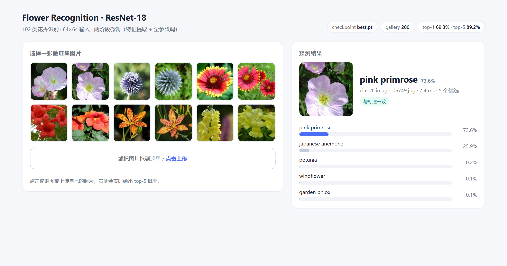
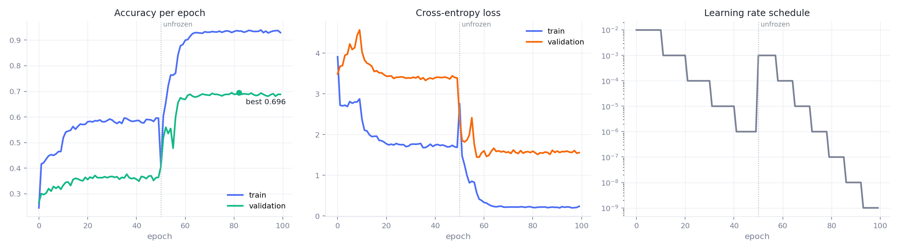
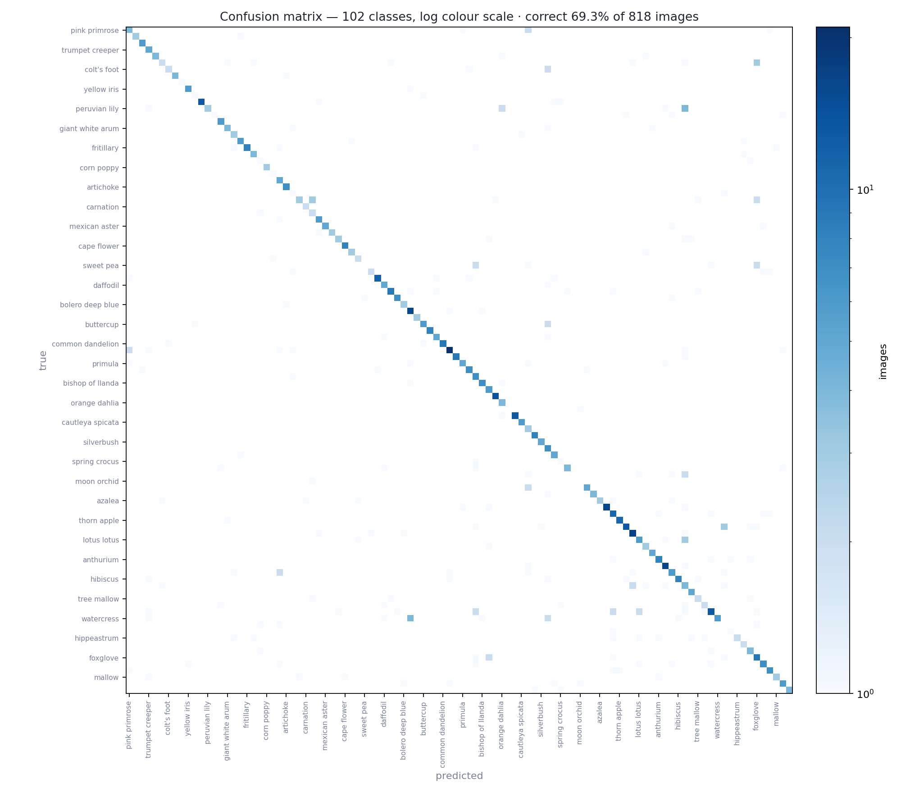
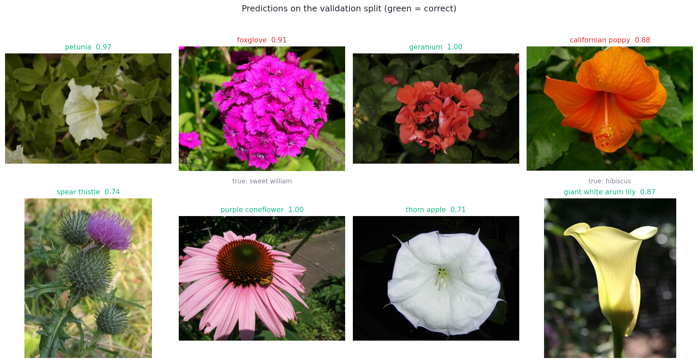
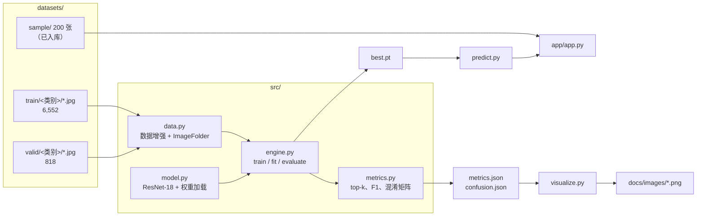
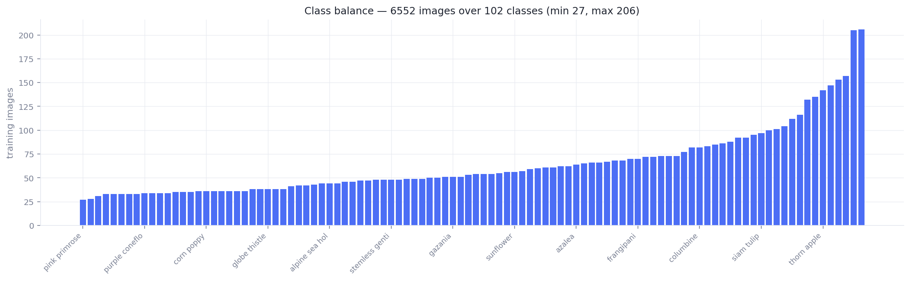

<div align="center">

# 花朵识别 · ResNet-18

**在 64×64 的裁剪图上分辨 102 种花卉：两阶段训练，附带可直接运行的演示页——以及那个让同类项目一上线就出错、却几乎没人注意的坑。**

[](https://www.python.org/)
[](https://pytorch.org/)
[](https://pytorch.org/vision/stable/)
[](https://flask.palletsprojects.com/)
[](LICENSE)

[English](README.md) · **简体中文**

[项目简介](#-项目简介) · [实验结果](#-实验结果) · [快速开始](#-快速开始) · [实现原理](#-实现原理) · [设计要点](#-设计要点) · [数据集](#-数据集) · [常见问题](#-常见问题)

</div>

<p align="center">
  
</p>

---

## 📌 项目简介

把 ImageNet 预训练的 ResNet-18 微调到能区分 102 种花卉，并且停在多数课程项目
「刚开始」的地方：权重能直接加载、不用猜 key 名；指标一条命令即可复现；图表由数据
重新生成而不是截图；演示页能识别新照片。

| | |
| :-- | :-- |
| **任务** | 102 分类单标签识别（Oxford Flowers 102 子集） |
| **模型** | ResNet-18，11.23 M 参数，输入 64×64 |
| **训练** | 2 阶段 × 50 epoch：先冻结骨干，再全参微调 |
| **验证集准确率** | top-1 **69.32 %** · top-3 **85.33 %** · top-5 **89.24 %** |
| **推理吞吐** | 约 243 张/秒（batch 128，RTX 3050 Laptop，fp32） |

真正有意思的不是「ResNet 能认花」，而是这类项目里三个会悄悄出错的地方，这里都处理了：

1. **类别索引与标签的错位。** `ImageFolder` 把文件夹名按**字符串**排序，于是顺序是
   `1, 10, 100, 101, 102, 11, …` 而不是 `1, 2, 3`。用 `str(index + 1)` 映射的演示页，
   102 个类里只有 1 个是对的。见 [`datasets/README.md`](datasets/README.md#why-classesjson-matters)。
2. **权重格式漂移。** 原来的四个脚本产生过三种格式（`{'state_dict': …}`、裸
   `state_dict`、`DataParallel` 包装）。现在由一个加载器统一兼容。
3. **会悄悄毁掉标签的数据增强。** 在 64 px 下，先旋转再裁剪、和先缩放再旋转，
   不是一回事。顺序在 `src/data.py` 里固定并写明了原因。

---

## 📊 实验结果

用发布的权重在 818 张验证集上实测（`python -m src.evaluate`）：

| 指标 | 数值 |
| :-- | --: |
| Top-1 准确率 | **0.6932** |
| Top-3 准确率 | 0.8533 |
| Top-5 准确率 | 0.8924 |
| 宏平均 F1 | 0.6551 |
| 加权 F1 | 0.6936 |
| 交叉熵 | 1.5116 |
| 吞吐（RTX 3050 Laptop，fp32，batch 128） | 243 张/秒 |

<sub>权重文件里记录着训练时的 `best_acc = 0.6956`。与这里相差 2 张图（0.24 个百分点），
属于正常范围：batch 组成与 cuDNN 选核会让极少数边界样本落到哪一侧发生变化。
两个数字都如实给出，而不是挑好看的那一个。</sub>

<p align="center">
  
</p>

从左往右读准确率那一栏，训练策略就一目了然：

- **第 0–49 epoch：冻结骨干。** 只训练新换的 102 路分类头。验证准确率爬到 0.36 后不再上升——
  512 维冻结特征撑不起 102 个细粒度类别。
- **第 50 epoch：解冻。** 从 0.36 到 0.69 只用了大约 6 个 epoch。这正是两阶段训练的全部理由：
  分类头先找到一个可用方向，骨干才开始移动，于是最初几步微调不会把预训练卷积核带跑偏。
- **第 56–99 epoch：过拟合区。** 训练准确率升到 0.93，验证停在 0.69。第 60 epoch 之后基本是记忆；
  发布权重取自第 82 epoch，即验证集最好的那一点。

<p align="center">
  
</p>

混淆是**弥散的，不是结构性的**：没有任何一对类别占主导，最大的非对角格也只有 3–4 张图。
这是一个「容量或分辨率不够」的模型的典型特征；如果类别映射错了，看到的会是一条实心的偏移对角线。

<p align="center">
  
</p>

<sub>随机抽取的八张验证图。其中两张判错，而且错得有信息量：石竹被认成 *foxglove*（毛地黄），
木槿被认成 *Californian poppy*（花菱草）。错误集中在颜色与花瓣形状相近的类别之间，
而不是随机落到别处。</sub>

准确率最低的几类（各自只有 1–6 张验证图）：

| 类别 | 验证样本数 | 错误落到 |
| :-- | --: | :-- |
| tiger lily | 1 | moon orchid |
| moon orchid | 1 | garden phlox |
| monkshood | 3 | foxglove、grape hyacinth、stemless gentian |
| windflower | 5 | columbine、clematis |
| sweet pea | 6 | foxglove、pelargonium |

每类只有一到六张图，这些不算「难类」，而是统计噪声——所以本文同时给出宏平均 F1，
而不是把长尾藏起来。

---

## 🚀 快速开始

| 目标 | 步骤 | 需要 |
| :-- | :-- | :-- |
| 只看结果 | 读完本页 | 浏览器 |
| 识别自己的照片 | 1 → 2 → 4 → 6 | Python + 45 MB 下载 |
| 跑网页演示 | 1 → 2 → 4 → 7 | 同上 |
| 复现指标 | 1 → 2 → 3 → 4 → 5 | 300 MB 数据集 |
| 从零训练 | … → 8 | 有 GPU 更好（CPU 也能跑，就是慢） |

### 1. 克隆

```bash
git clone https://github.com/wushaw1102/Flower-Recognition-Based-on-ResNet18.git
cd Flower-Recognition-Based-on-ResNet18
```

### 2. 准备环境

```bash
python -m venv .venv && source .venv/bin/activate     # Windows: .venv\Scripts\activate
pip install torch==2.2.0 torchvision==0.17.0 --index-url https://download.pytorch.org/whl/cu121
pip install -r requirements.txt
```

只有 CPU 也可以：去掉 `--index-url` 那行，直接从 PyPI 装 `torch==2.2.0`。

### 3. 准备数据集

6,552 + 818 张图片不在仓库里（约 300 MB）。解压到
`datasets/flowers/{train,valid}/<类别id>/*.jpg`，格式见[数据集](#-数据集)一节。
仓库里已带 200 张样本，所以不下载数据也能走完第 4–7 步。

### 4. 下载权重

`weights/flower_resnet18.pth`（43 MB，仅 state_dict）以 Release 附件形式发布：

```bash
mkdir -p weights
curl -L -o weights/flower_resnet18.pth \
  https://github.com/wushaw1102/Flower-Recognition-Based-on-ResNet18/releases/download/v1.1.0/flower_resnet18.pth
```

也可以直接在浏览器里从 [v1.1.0 Release 页面](https://github.com/wushaw1102/Flower-Recognition-Based-on-ResNet18/releases/tag/v1.1.0) 下载。

### 5. 复现指标

```bash
python -m src.evaluate --output-dir outputs/eval
```

```
images 818 | classes 102
accuracy      0.6932
top-3 / top-5 0.8533 / 0.8924
macro F1      0.6551
throughput    243 images/s (3.4s for 818)
```

`outputs/eval/` 下会生成 `metrics.json`、`confusion.json`、`predictions.csv`。

### 6. 识别一张照片

```bash
python -m src.predict --image datasets/sample/images/class1_image_06749.jpg
```

```
pink primrose                     0.736  #############################
japanese anemone                  0.259  ##########
petunia                           0.002
windflower                        0.001
garden phlox                      0.001
```

批量模式用 `--dir` 输出 CSV；加 `--json` 打印完整 top-k 结构。

### 7. 启动演示

```bash
python app/app.py --port 5088      # → http://127.0.0.1:5088
```

左侧 12 张样本缩略图，中间可拖拽上传，右侧是 top-5 概率条。模型在启动时预热过，
所以界面上的耗时是稳定值（约 7 毫秒/张），而不是首次调用的 400 毫秒。

### 8. 重新训练

```bash
python -m src.train --epochs 50 --batch-size 128 --amp --plateau --patience 8
```

输出 `outputs/resnet18-64/best.pt` 与 `history.csv`（每个 epoch 一行，含 top-3/top-5 与学习率）。
`--epochs` 是「每个阶段」的轮数，所以上面这条命令复现的是 100 个 epoch 的完整策略。

### 9. 重新生成文中所有图表

```bash
python scripts/import_training_log.py       # 旧 CSV -> history.csv
python -m src.visualize --checkpoint weights/flower_resnet18.pth
```

---

## 🏗 实现原理



### 两阶段策略

```
阶段一（50 epoch，lr 1e-2）            阶段二（50 epoch，lr 1e-3）
┌─────────────────────────┐          ┌─────────────────────────┐
│ 骨干网络  🔒 冻结        │          │ 骨干网络  🔓 参与训练    │
│ fc 512→102  ✅ 训练      │   ──▶    │ fc        ✅ 训练        │
│ StepLR 每 10 epoch 衰减  │          │ StepLR 每 7 epoch 衰减   │
│ 验证准确率 → 0.36        │          │ 验证准确率 → 0.69        │
└─────────────────────────┘          └─────────────────────────┘
```

先冻结不是为了省时间——原封不动的骨干产出的特征，已经足以把分类头放到损失曲面上一个
合理的位置。从这里以 10 倍小的学习率解冻，预训练的纹理/边缘检测器能保持完好，
网络改而去适应花瓣，而不是继续认毛发和车轮。

### 预处理链路

| 阶段 | 步骤 |
| :-- | :-- |
| 训练 | `Resize(96)` → `RandomRotation(45)` → `CenterCrop(64)` → 水平/垂直翻转 → `ColorJitter` → `RandomGrayscale(0.025)` → `ToTensor` → ImageNet 标准化 |
| 验证 / 推理 | `Resize(64)` → `ToTensor` → ImageNet 标准化 |

先在 96 px 画布上旋转、再裁到 64 px，可以把旋转引入的零填充留在裁剪窗口之外。
反过来做，就是在教模型「黑色楔形是花的一部分」。

### 类别顺序这个坑，用代码说明

```python
# torchvision.datasets.ImageFolder(TRAIN).classes →
#   ['1', '10', '100', '101', '102', '11', ...]      ← 字符串排序，不是数值排序
labels = [names[folder] for folder in load_class_order()]   # 正确
# labels = [names[str(i + 1)] for i in range(102)]          # 102 个类里错 101 个
```

`datasets/classes.json` 在第一次打开数据集时写入，之后训练、评估、混淆矩阵和演示页
都读同一份，不可能出现口径不一致。

---

## 🧠 设计要点

**1 · 一个加载器，兼容三种权重格式。** `first.py` 存的是带优化器状态的字典，
`final_model.pth` 是裸 `state_dict`，用 `DataParallel` 跑过的权重每个 key 都带 `module.` 前缀。
`src.model.load_checkpoint` 全部兼容，遇到多余 key 会提示而不是直接崩。

**2 · 指标只算一遍。** 早期版本为了拿准确率和分类报告把模型跑了两遍，吞吐凭空减半。
现在 `engine.evaluate` 一次遍历同时返回统计量、标签和 logits；`metrics.py` 不依赖
scikit-learn，训练循环和命令行共用同一套实现。

**3 · 照顾 Windows 的 DataLoader 默认值。** Windows 上 `num_workers=4` 会拉起四个各自
import torch 的解释器，第一批数据之前就花掉约 33 秒。现在 Windows 默认 0、其他平台 4，
在 818 张图上相差 36 秒 vs 3.4 秒。

**4 · 图表是算出来的，不是截出来的。** 训练曲线、混淆矩阵、预测网格、类别分布全部由
`src/visualize.py` 读取 `metrics.json`、`confusion.json`、`history.csv` 生成，
README 里的数字和图片不会各自漂移。

**5 · 发布 43 MB 而不是 128 MB。** `best.pt` 里带着最后一步的优化器状态；Release 附件
只保留纯 `state_dict`，推理需要的仅此而已。

**6 · 保留历史，而不是抹掉。** 四个原始脚本留在 `legacy/`，并用一张表说明各自改了什么、
哪一个产出了现在的权重。`scripts/import_training_log.py` 把它们的 CSV 转成当前格式，
而不是伪造一份现在的训练器从未产出过的日志。

---

## 📁 目录结构

```
.
├── README.md / README.zh-CN.md     英文版 · 中文版
├── LICENSE                          MIT
├── requirements.txt                 版本固定，已在 PyTorch 2.2 / CUDA 12.1 验证
├── src/
│   ├── config.py                    路径、常量、权重定位
│   ├── data.py                      数据增强、ImageFolder 装配、样本索引
│   ├── model.py                     ResNet-18 + 多格式权重加载
│   ├── engine.py                    训练/评估循环、两阶段策略
│   ├── metrics.py                   top-k、宏平均 F1、混淆矩阵（不依赖 sklearn）
│   ├── train.py                     命令行：两阶段微调
│   ├── evaluate.py                  命令行：输出指标包
│   ├── predict.py                   命令行：单张 / 整个目录
│   └── visualize.py                 生成本文全部图表
├── app/
│   ├── app.py                       Flask 演示（图库 + 上传 + top-5）
│   └── templates/index.html         单页，无需构建
├── scripts/
│   ├── make_sample.py               生成 datasets/sample（类别均衡）
│   └── import_training_log.py       旧 CSV → history.csv
├── datasets/
│   ├── cat_to_name.json             类别 id → 花名
│   ├── classes.json                 ImageFolder 的真实类别顺序
│   ├── sample/                      200 张已入库图片 + index.csv
│   └── README.md                    数据格式与类别顺序的坑
├── docs/
│   ├── images/                      生成的图表
│   └── README.md                    每张图由哪个脚本产出
├── legacy/                          四个原始脚本及其训练日志
└── weights/                         权重放这里（已 gitignore）
```

---

## 🗃 数据集

| 划分 | 类别 | 图片数 | 每类数量 |
| :-- | --: | --: | :-- |
| train | 102 | 6,552 | 27 – 206（中位数 54） |
| valid | 102 | 818 | 1 – 28（中位数 7） |

来自 udacity 课程提供的 `flower_data`（Oxford Flowers 102 的子集）。原数据不随仓库分发，
格式与下载方式见 [`datasets/README.md`](datasets/README.md)。已入库的 `sample/` 是 200 张
类别均衡的图片，足以把评估流程和演示完整跑通。

<p align="center">
  
</p>

---

## ⚠️ 范围与限制

下面几条比那个好看的数字更重要：

- **64 px 下 69 % 的 top-1 是分辨率的天花板。** 同样的 ResNet-18 在 224 px 上通常能到 85 % 以上。
  选 64 px 是有意的：它能在 4 GB 显存的笔记本 GPU 上跑完 100 个 epoch，而这个项目的重点是流程，不是刷榜。
- **有 5 个类事实上无法评估**（验证集 1–6 张）。它们的 0 % 说明不了模型好坏。
- **没有独立测试集。** 所有数字都是「用来挑最优 epoch 的那个验证集」上的准确率，因此偏乐观一点点。
- **数据集本身含有标注噪声。** 至少有一张标为 *pink primrose* 的验证图其实是粉花月见草，
  模型在那张图上自信地说 *japanese anemone*，未必全是模型的错。
- **CPU 也能推理，但慢约 30 倍**；演示页假设有可用的 GPU。

---

## ❓ 常见问题

<details>
<summary><b>为什么用 64×64 而不是 224×224？</b></summary>

<br/>

原始课程的硬件目标是 4 GB 显存的笔记本 GPU。64 px 下 ResNet-18 跑完 100 个 epoch
远不到一小时，增强后的数据也能整体放进内存。代价是约 16 个百分点的准确率，
这一点写在上面，而不是藏起来。

</details>

<details>
<summary><b>演示页有时会给出错误答案，置信度却很高？</b></summary>

<br/>

102 个细粒度类别、64 px 输入：长相相近的品种在颜色和花瓣统计上几乎一样。
另外训到 100 epoch 后校准也不佳——softmax 的置信度并不等于「答对的概率」。
top-5 有 0.89，正是因为 top-1 只有 0.69。

</details>

<details>
<summary><b>可以用自己的照片吗？</b></summary>

<br/>

可以——演示页支持拖拽上传，命令行用 `python -m src.predict --dir <目录>` 输出 CSV。
构图尽量接近数据集（整朵花、大致居中）；64 px 对裁剪非常敏感。

</details>

<details>
<summary><b>为什么保留四个旧脚本，而不是删掉？</b></summary>

<br/>

它们是实验记录。`legacy/README.md` 写清了每个脚本改了什么、哪个产出了现在的权重；
删掉之后，README 里的说法就无法验证了。

</details>

<details>
<summary><b>怎么确认这些指标是真的？</b></summary>

<br/>

`python -m src.evaluate` 会从权重和图片重新算一遍，并输出 `predictions.csv`，
每张图一行，准确率可以自己数。图表用的也是同一批 JSON。

</details>

---

## 🙏 致谢

- **数据集** — udacity 的 `flower_data`，属于
  [Oxford Flowers 102](https://www.robots.ox.ac.uk/~vgg/data/flowers/102/)
  （Nilsback & Zisserman, 2008）的子集。
- **预训练权重** — `torchvision.models.resnet18`，ImageNet-1k。
- **原始脚本** — 为 PyTorch 课程练习编写，保存在 [`legacy/`](legacy/) 并附有说明。

---

## 📄 许可证

[MIT](LICENSE) © 2026 wushaw1102。数据集图片不适用本许可证。
